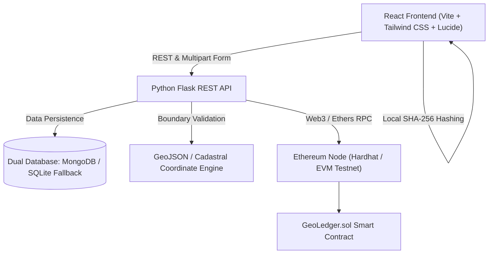

# 🌍 GeoLedger

> **Decentralized Geospatial Cadastral Registry & Blockchain Land Title Verification System**

GeoLedger is an end-to-end decentralized land registry platform that marries **Geographic Information Systems (GIS)** with **Ethereum Smart Contracts** to provide tamper-proof, transparent, and verifiable property ownership, transfer workflows, and cryptographic document authentication.

---

## 🌟 Key Features

- **🗺️ Interactive GIS Cadastral Mapping**
  - Leaflet-powered geospatial visualization of land parcels with boundary polygons, surveyed coordinates, and cadastral overlays.
  - Interactive parcel selection with instant cadastral inspection and direct deed actions.
- **⛓️ Smart Contract Title Registry**
  - Ethereum / EVM-compatible smart contracts (`GeoLedger.sol`) recording immutable property registration and ownership transfers on-chain.
  - Transparent provenance tracking and cryptographic transaction receipts.
- **📄 Cryptographic Document Verification**
  - Client-side SHA-256 document hashing via the Web Crypto API (`crypto.subtle.digest`).
  - Documents are verified locally without exposing private file data to servers; hashes are matched against anchored ledger records.
- **🏛️ Workflow & State Machine Engine**
  - Structured multi-step registration wizard (Property Details, Boundary Coordinates, Owner Identity, and Legal Document Uploads).
  - Lifecycle state tracking: `SUBMITTED` ➔ `UNDER_REVIEW` ➔ `DOCUMENTS_PENDING` ➔ `VERIFIED` ➔ `APPROVED` ➔ `COMPLETED` (on-chain anchoring).
- **🔄 Frictionless Ownership Transfers**
  - Formal transfer proposals with counterparty verification, consideration records, and smart-contract execution.
- **📊 Real-time Dashboard & Activity Feed**
  - Live ledger statistics, recent transaction audits, registered property inventories, and notification feeds.

---

## 🏗️ Architecture & Technology Stack



| Layer | Technologies |
|---|---|
| **Frontend** | React 18, TypeScript, Vite, Tailwind CSS, Lucide Icons, Leaflet / React-Leaflet |
| **Backend** | Python 3.12+, Flask, Flask-CORS, PyMongo / SQLite fallback, Dotenv |
| **Blockchain** | Solidity `^0.8.20`, Hardhat, Ethers.js v6 |
| **Security** | Web Crypto SHA-256 local hashing, Role-based verification, Input Sanitization |

---

## 📂 Project Structure

```plaintext
GeoLedger/
├── backend/                    # Python Flask backend API
│   ├── app.py                  # Application factory and route registration
│   ├── config.py               # Environment configuration
│   ├── controllers/            # Request handlers (auth, doc, ownership, property, etc.)
│   ├── database/               # Database client (MongoDB + SQLite fallback + seed data)
│   ├── geojson/                # Cadastral parcel GeoJSON specifications
│   ├── models/                 # Data schemas (property, document, transaction, etc.)
│   ├── routes/                 # Blueprint endpoints
│   ├── services/               # Core business & blockchain bridge services
│   └── tests/                  # Backend unit & integration test suites
├── blockchain/                 # Hardhat blockchain workspace
│   ├── contracts/              # Solidity contracts (GeoLedger.sol)
│   ├── deploy-local.js         # Deployment script
│   ├── deployed-address.json   # Contract deployment artifact
│   └── hardhat.config.js       # Hardhat network configuration
└── frontend/                   # React + TypeScript frontend
    ├── src/
    │   ├── app/
    │   │   ├── components/
    │   │   │   ├── Layout.tsx      # Responsive shell with sidebar
    │   │   │   ├── Sidebar.tsx     # Navigation links & UI state
    │   │   │   └── screens/        # Core application views (Dashboard, Search, Register, etc.)
    │   │   └── App.tsx             # React Router routing configuration
    │   └── services/
    │       └── api.ts              # Axios client communicating with backend
    ├── package.json
    └── vite.config.ts
```

---

## 🚀 Quick Start Guide

### Prerequisites
- **Node.js** (v18.x or v20.x recommended) & **npm** / **pnpm**
- **Python** (v3.10+ recommended)
- **Git**

---

### 1. Smart Contract & Blockchain Setup

Navigate to the `blockchain` directory to install dependencies and run a local Ethereum node:

```bash
cd blockchain
npm install

# Start local Hardhat EVM node
npx hardhat node
```

In a second terminal, deploy the contract to your local node:

```bash
cd blockchain
npx hardhat run deploy-local.js --network localhost
```

---

### 2. Backend API Setup

Navigate to the `backend` directory, set up your Python virtual environment, and launch the Flask server:

```bash
cd backend

# Create and activate virtual environment
python -m venv venv
# On Windows:
venv\Scripts\activate
# On Linux/macOS:
source venv/bin/activate

# Install requirements
pip install flask flask-cors pymongo python-dotenv web3

# Run the backend (defaults to SQLite fallback if MongoDB is not running)
python app.py
```
> *The backend server will run on `http://localhost:5000` (or configured port).*

---

### 3. Frontend Setup

Navigate to the `frontend` directory, install packages, and start the development server:

```bash
cd frontend
npm install

# Run the Vite development server
npm run dev
```
> *Open your browser at `http://localhost:5173` to explore the GeoLedger portal.*

---

## 🔌 API Overview

| Method | Endpoint | Description |
|---|---|---|
| `GET` | `/properties` | List registered land parcels with pagination and filters |
| `GET` | `/properties/<id>` | Fetch detailed parcel metadata and ownership records |
| `POST` | `/applications/create` | Submit new title registration application |
| `GET` | `/applications/<id>` | Retrieve full status history of an application |
| `POST` | `/documents/upload` | Upload supporting deed documents |
| `POST` | `/ownership/transfer` | Execute or request an ownership transfer |
| `GET` | `/verify/property/<identifier>`| Public zero-knowledge style verification check |
| `GET` | `/blockchain/transactions` | Query confirmed ledger transaction log |

---

## 🔒 Security & Privacy

- **Local Hash Verification**: Files are never transmitted in raw form for verification checks. Cryptographic SHA-256 signatures are generated in the browser and checked against the distributed ledger.
- **Environment Isolation**: Database credentials, private keys, and session keys are secured in `.env` and kept strictly out of version control.
- **Tamper Evidence**: Any modification to a land deed or boundary polygon yields an irreconcilable hash mismatch.

---

## 📄 License

This project is licensed under the [MIT License](LICENSE).
